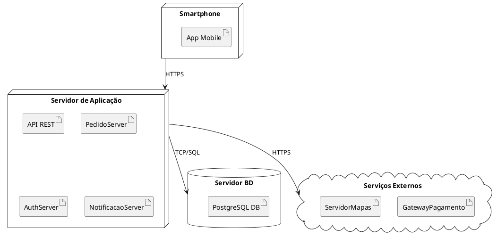
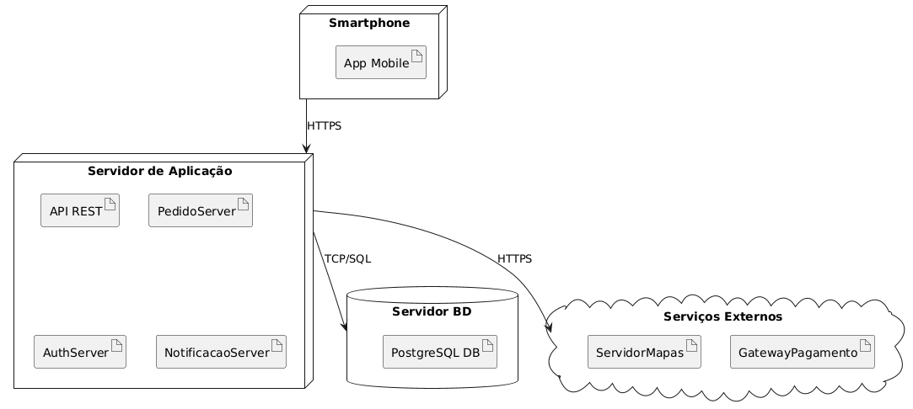

## Atividade

Implemente a seguinte diagrama: 

> **Nós**
>   - **Smartphone** — executa o App Mobile
>   - **Servidor de Aplicação** — executa:
>       - API REST
>       - PedidoService
>       - AuthService
>       - NotificaçãoService
> - **Servidor de Banco** — executa o Banco de Dados
> - **Serviços Externos** — disponibiliza:
>       - Gateway Pagamento
>       - Serviço de Mapas
> **Conexões**
> - Smartphone → Servidor de Aplicação — **HTTPS**
> - Servidor de Aplicação → Servidor de Banco — **TCP/SQL**
> - Servidor de Aplicação → Serviços Externos — **HTTPS**

- - - 

## Resposta:

### Codigo:

### Resultado

